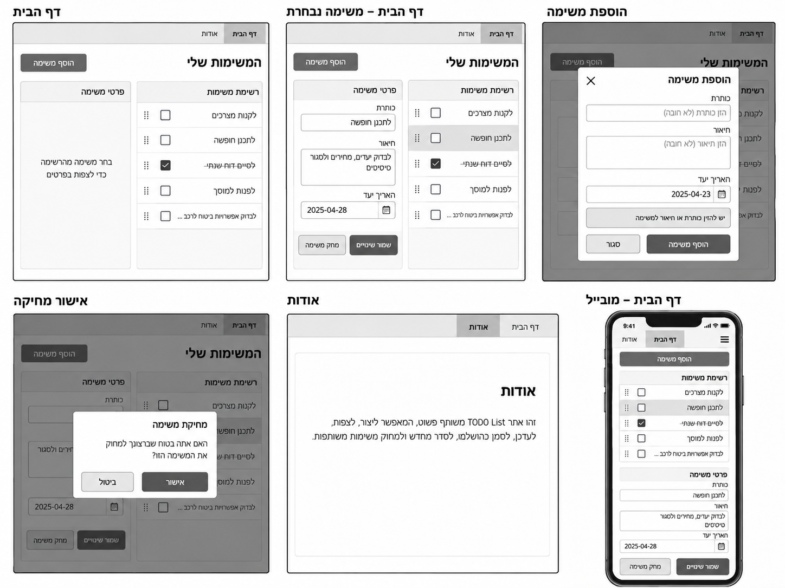
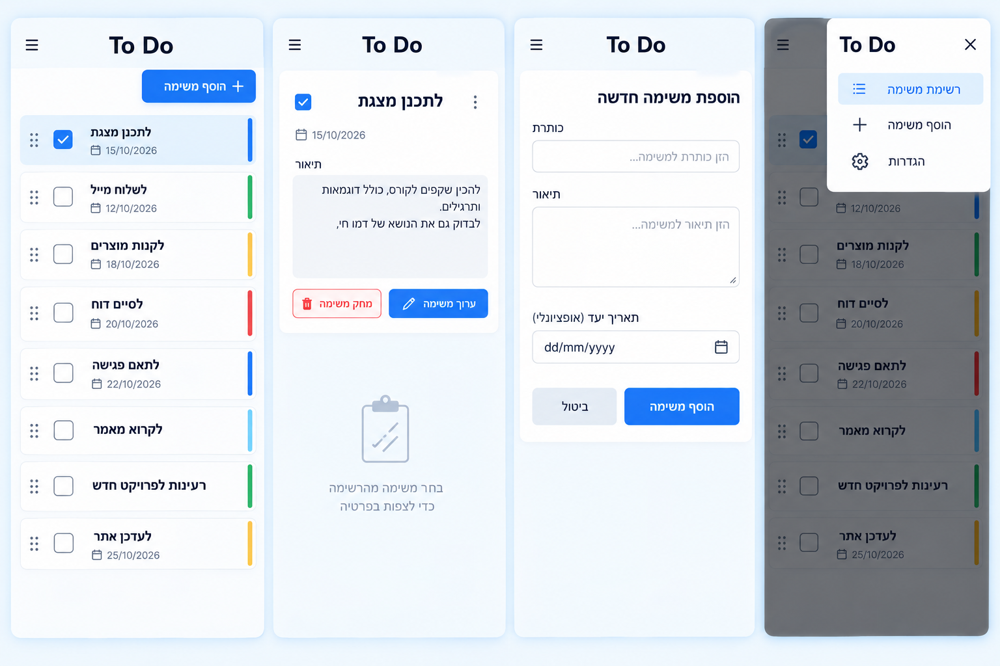
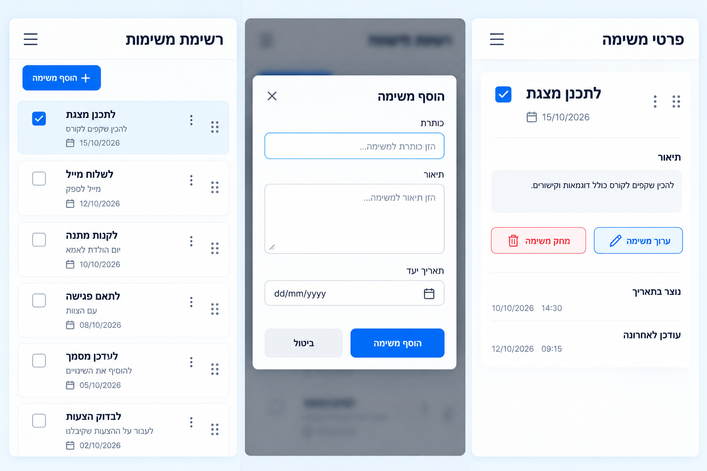
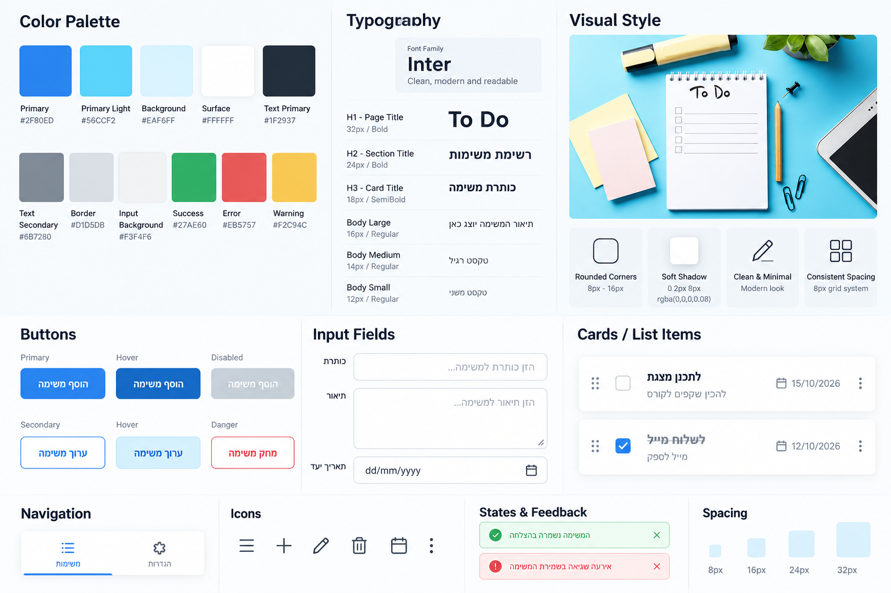

# DESIGN – עיצוב אתר TODO List משותף

מסמך זה מגדיר את מבנה הממשק ואת שפת העיצוב למימוש. הדרישות העסקיות, כללי האימות וההתנהגויות המחייבות מפורטים ב-`PRD.md` ואינם משוכפלים כאן.

**סדר עדיפות במקרה של אי-התאמה בין המקורות:** `PRD.md` קובע את היכולות וההתנהגות; `wireframes.png` קובע את מבנה המסכים; `style-guide.png` קובע את הסגנון והערכים החזותיים; `mockups1.png` ו-`mockups2.png` מספק השראה לגימור החזותי רק במקומות שאינם סותרים את המקורות הקודמים. בפרט, ה-Mockups אינם משמרים במדויק את ששת מצבי התצוגה של ה-Wireframes, ומופיעים בהם פרטי משימה ותפריטים שלא אושרו. אין לממש תוספות אלו.

## 1. Screens – מסכי האפליקציה

האפליקציה כוללת **שני דפים בלבד**: דף הבית ודף אודות. הוספת משימה ואישור מחיקה הם מצבי Modal מעל דף הבית, לא דפים עצמאיים. יתר הדוגמאות להלן הן מצבי תצוגה Responsive של אותו דף.

### 1.1 דף הבית – ללא משימה נבחרת

- **מטרה:** סקירת רשימת המשימות המשותפת ובחירת משימה לטיפול.
- **מבנה ותוכן:** תפריט ניווט עם הקישורים **דף הבית** ו-**אודות**; כותרת האזור **המשימות שלי**; כפתור **הוסף משימה**; אזור **רשימת משימות**; אזור **פרטי משימה**. במחשב שני האזורים מוצגים זה לצד זה: הרשימה בצד ימין, הפרטים בצד שמאל, בהתאם ל-RTL. בכל שורת משימה מופיעים טקסט מזהה, Checkbox וידית Drag & Drop. כאשר אין משימה נבחרת, אזור הפרטים מציג: **בחר משימה מהרשימה כדי לצפות בפרטיה**. כאשר הרשימה מלאה (1,000 משימות), כפתור **הוסף משימה** מוצג במצב Disabled לפי ה-Style Guide, ולצדו הודעה קצרה שהרשימה מלאה.
- **פעולות וניווט:** בחירת שורה מציגה את פרטי המשימה; Checkbox משנה את מצב ההשלמה; גרירה משנה סדר; **הוסף משימה** פותח Modal; התפריט מנווט לדף אודות.
- **הצגת מידע:** טקסט השורה הוא הכותרת או תחילת התיאור אם אין כותרת; טקסט ארוך נקטע באופן חזותי. משימה שהושלמה מסומנת ב-Checkbox מסומן וטקסט חצוי. הרשימה נשארת רשימה אחת.

### 1.2 דף הבית – משימה נבחרת

- **מטרה:** צפייה ועריכה ישירה של המשימה הנבחרת.
- **מבנה ותוכן:** הרשימה ותפריט הניווט נותרים במקומם; השורה שנבחרה מובחנת באמצעות רקע עדין. באזור **פרטי משימה** מוצגים שדה **כותרת**, שדה **תיאור** מרובה שורות, שדה **תאריך יעד** וכפתורי **שמור שינויים** ו-**מחק משימה**. השדות ניתנים לעריכה מיד, ללא מצב Edit נפרד.
- **פעולות וניווט:** **שמור שינויים** מבצע שמירה; **מחק משימה** פותח אישור מחיקה; לחיצה על משימה אחרת מחליפה את הפרטים המוצגים. שינויים שלא נשמרו מתבטלים בהתאם ל-PRD.
- **מצב שגיאה:** הודעת Validation מופיעה בתוך אזור הטופס, ליד השדות הרלוונטיים; במקרה של כישלון שמירה ערכי השדות נשארים גלויים.

### 1.3 הוספת משימה – Modal

- **מטרה:** יצירת משימה חדשה מבלי לצאת מדף הבית.
- **מבנה ותוכן:** שכבת Overlay אפורה ושקופה-למחצה מעל דף הבית, ומעליה חלון לבן ממורכז בעל פינות מעוגלות. כותרת **הוספת משימה**, אמצעי סגירה, שדות **כותרת**, **תיאור**, **תאריך יעד**, וכפתורי **הוסף משימה** ו-**סגור**. הכותרת והתיאור ריקים עם Placeholders בעברית; תאריך היעד מתחיל בתאריך הנוכחי, ואפשר לנקותו.
- **פעולות וניווט:** הוספה מוצלחת סוגרת את החלון ומחזירה לרשימה המעודכנת, כשהמשימה החדשה נבחרת ופרטיה מוצגים באזור הפרטים; סגירה ללא שמירה מבטלת את ההזנה. שגיאת Validation מוצגת בתוך ה-Modal בלי למחוק את הנתונים.

### 1.4 אישור מחיקה – Modal

- **מטרה:** למנוע מחיקה מקרית של המשימה הנבחרת.
- **מבנה ותוכן:** דף הבית מוחשך ב-Overlay; חלון אישור קטן וממורכז מכיל כותרת **מחיקת משימה**, את השאלה **האם אתה בטוח שברצונך למחוק את המשימה הזו?**, וכפתורי **ביטול** ו-**אישור**.
- **פעולות וניווט:** **ביטול** סוגר את החלון ללא שינוי; **אישור** מבצע מחיקה. לאחר הצלחה אזור פרטי המשימה חוזר להודעת הבחירה.

### 1.5 דף אודות

- **מטרה:** הסבר קצר ופשוט על האתר.
- **מבנה ותוכן:** אותו תפריט ניווט עקבי, כשהדף **אודות** מסומן כפעיל. אזור תוכן מרכזי, כותרת **אודות** ופסקת הסבר קצרה על ניהול רשימת TODO List משותפת, ללא התחברות.
- **פעולות וניווט:** מעבר לדף הבית באמצעות התפריט.

### 1.6 דף הבית – תצוגת מובייל

- **מטרה:** לאפשר את כל פעולות דף הבית במסך Android צר.
- **מבנה ותוכן:** תוכן אנכי לפי RTL: ניווט מותאם לרוחב המסך, כפתור **הוסף משימה**, אזור **רשימת משימות**, ומתחתיו אזור **פרטי משימה**. כל משימה כוללת Checkbox, טקסט וידית גרירה הנגישה למגע. השדות והכפתורים באזור הפרטים מתאימים לרוחב הזמין. הצגה אנכית או גלילה מחליפות את הפריסה הדו-עמודתית של הדסקטופ. אייקון ההמבורגר המופיע ב-Wireframe של המובייל אינו ממומש: הניווט כולל שני קישורים גלויים בלבד.
- **פעולות וניווט:** אותן פעולות כמו בדסקטופ, לרבות Drag & Drop במגע, שמירה, מחיקה ופתיחת Modal.

### ניווט כללי

ניווט קבוע בין **דף הבית** ו-**אודות** בלבד. כל היצירה, הבחירה, העריכה, שינוי הסטטוס, הסידור והמחיקה מתבצעים בדף הבית. ה-Modal-ים נפתחים מעל דף הבית ואינם יוצרים נתיב ניווט חדש. במובייל ההתאמה היא שינוי פריסה ולא הוספת דף או Feature.

## 2. Style Guide – השפה העיצובית

### 2.1 Color Palette

הפלטה נובעת מצילום המחברת על משטח תכלת: תכלת וטורקיז בהירים, נייר לבן, צבעי פתקים פסטליים וטקסט כהה. הערכים שלהלן נלקחו מה-Style Guide החזותי.

| Design Token | HEX | שימוש עיצובי |
|---|---|---|
| `primary` | `#2F80ED` | פעולות ראשיות, מצב פעיל, הדגשת Focus |
| `primary-light` | `#56CCF2` | נגיעות תכלת ו-Hover עדין |
| `background` | `#EAF6FF` | רקע כללי רך |
| `surface` | `#FFFFFF` | כרטיסים, טפסים ו-Modal |
| `text-primary` | `#1F2937` | כותרות וטקסט ראשי |
| `text-secondary` | `#6B7280` | טקסט משני ו-Placeholder |
| `border` | `#D1D5DB` | קווי מתאר והפרדות |
| `input-background` | `#F3F4F6` | רקע שדות/אזורים עדינים |
| `success` | `#27AE60` | משוב הצלחה |
| `error` | `#EB5757` | שגיאה ופעולת מחיקה |
| `warning` | `#F2C94C` | גוון משלים במערכת הצבעים; אינו מחייב מצב מוצר חדש |

הגוונים הבהירים ורקעי המשטח ישלטו במסכים; כחול רווי מיועד לאינטראקציות מרכזיות, ואדום למחיקה ולשגיאות. אין להשתמש בפסי צבע כקידוד עדיפויות: למוצר לא הוגדרה עדיפות למשימה.

### 2.2 Typography

- **משפחת גופנים:** ה-Style Guide מציג `Inter` כסגנון Sans-serif מודרני. לטקסט עברי יש להשתמש במשפחת Sans-serif בעלת תמיכה עברית תקינה ובמראה דומה; `Inter` מתאים למחרוזות לטיניות ומספרים. הגופן העברי המדויק אינו מוגדר בתמונה ולכן אינו נקבע כאן כעובדה.
- **H1 / Page Title:** `32px`, `Bold`.
- **H2 / Section Title:** `24px`, `Bold`.
- **H3 / Card Title:** `18px`, `Semibold`.
- **Body Large:** `16px`, `Regular`.
- **Body Medium:** `14px`, `Regular`.
- **Body Small:** `12px`, `Regular`.
- כותרות קצרות ובולטות; תוויות שדות וערכי תוכן נשארים קריאים גם במובייל. טקסטי UI יוצגו בעברית.

### 2.3 UI Style

- **כפתורים:** Primary בכחול `#2F80ED`, טקסט לבן ופינות מעוגלות; Secondary במשטח לבן עם מסגרת כחולה או רקע בהיר; פעולת מחיקה בהדגשת אדום `#EB5757`. Hover עדין ואבחנה חזותית למצב Disabled, בהתאם לדוגמאות ה-Style Guide.
- **שדות קלט:** שדות רחבים עם פינות מעוגלות, גבול אפור בהיר, רקע לבן/אפור בהיר, Placeholder אפרפר וטקסט מיושר לימין. שדה התיאור גבוה ומאפשר מספר שורות; לשדה התאריך בקר תאריך ברור, ללא רכיב שעה. תצוגת התאריך בשדה נקבעת על ידי בקר התאריך המובנה של Chrome; ההבדל בין `2025-04-28` ב-Wireframes לבין `dd/mm/yyyy` ב-Style Guide אינו דרישה לפורמט מסוים.
- **כרטיסים ואזורים:** רקע Surface לבן, גבול בהיר, רדיוס מעוגל וצל רך. רשימת המשימות ופרטי המשימה מחולקים לאזורים חזותיים נפרדים. השורה הפעילה מקבלת הדגשה תכלכלה עדינה. אין להציג בתצוגת הרשימה תיאור מלא או תאריך תחת הכותרת: ב-PRD הוגדר שברשימה יופיע טקסט מזהה בלבד.
- **Checkbox:** ריבוע מעוגל מעט, סימון כחול כשהמשימה הושלמה, בתוספת טקסט חצוי למשימה שהושלמה. אינו מפעיל עריכה של השורה.
- **תפריט ניווט:** שני יעדים בלבד – **דף הבית** ו-**אודות**. פריט פעיל מובחן בצבע כחול/רקע עדין. אין להעתיק דוגמאות כגון **הגדרות** מה-Style Guide או מה-Mockups; הן דוגמאות סגנוניות בלבד.
- **אייקונים:** אייקוני קו פשוטים, במשקל קו עקבי ובצבע כהה/כחול לפי מצב: הוספה, סגירה, לוח שנה, מחיקה וידית Drag & Drop. הימנעות מקישוט יתר.
- **Feedback:** הודעות Validation ושגיאות בתוך הטופס בגוון אדום עדין; משוב הצלחה, אם מוצג כחלק מחיווי שמירה, יכול להיעזר בגוון הירוק המוגדר, בלי לדרוש Flow נוסף.
- **Modal:** רקע לבן, צל רך ופינות מעוגלות מעל Overlay כהה שקוף; היררכיה ברורה של כותרת, שדות/הודעה וכפתורי פעולה.

### 2.4 Visual Style, Layout & Spacing

- **אווירה:** נקייה, ידידותית, משרדית-קלילה ופשוטה, בהשראת דף מחברת לבן, רקע תכלת ופתקים עדינים. שימוש בצבע ובמרווחים במקום בעיטורים מורכבים.
- **צורות:** מלבנים וכרטיסים עם פינות מעוגלות של כ-`8–16px`, לפי ה-Style Guide; קווי מתאר דקים.
- **צללים:** צל רך ודיסקרטי, בדוגמת `0 2px 8px rgba(0,0,0,0.08)` המופיעה ב-Style Guide.
- **Spacing:** מערכת מרווחים מבוססת יחידות של `8px`, עם דוגמאות `8 / 16 / 24 / 32px`. להשתמש במרווחים עקביים בין תוויות לשדות, בין שורות ברשימה, בין כפתורים, בין אזורי תוכן ובין טקסט לתמונות, אם קיימות.
- **פריסת דסקטופ:** Header/Navigation בראש הדף; מתחתיו אזור עבודה עם רשימת משימות מימין ופרטי משימה משמאל, במשטחים מובחנים ובמרווח קבוע ביניהם.
- **פריסת מובייל:** עמודה יחידה; רשימת המשימות מעל הפרטים. רכיבי טופס וכפתורים מותאמים לרוחב מסך צר. גלילה אנכית כאשר התוכן ארוך מה-Viewport.
- **תמונות ואיורים:** תמונת ההשראה מגדירה את האווירה בלבד. אין דרישה להוסיף צילום המחברת כרקע או כתמונה במסכי האפליקציה; ה-Mockups וה-Wireframes מתארים בעיקר ממשק פונקציונלי ללא תמונות תוכן.

### 2.5 שפה וכיווניות

- **שפת ממשק:** עברית בלבד.
- **כיווניות בסיס:** `RTL` ברמת הדפים, ה-Modal-ים, התפריט והשדות. כותרות, תוויות, הודעות וכפתורים בעברית וביישור המתאים ל-RTL.
- **תוכן מעורב:** תאריכים, מספרים ומונחים באנגלית, אם קיימים בתוכן, יוצגו בסדר תווים תקין בתוך ממשק RTL. תאריך יעד מוצג כתאריך בלבד.
- **התאמה למקורות:** טקסטים לטיניים כמו `To Do` ב-Inspiration Board משמשים השראה חזותית ואינם מחליפים את שפת הממשק העברית או את כותרות ה-Wireframes.
